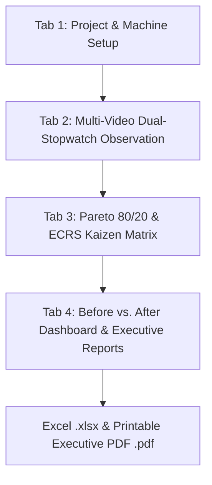

# ⚙ SMED Studio - Industrial Kaizen Video Analyzer

> **Single-Minute Exchange of Die (SMED) Desktop Suite**  
> *100% Offline Standalone Desktop Application for Industrial Engineers, Lean Leaders, and Kaizen Champions.*

[](https://www.python.org/)
[](https://www.riverbankcomputing.com/software/pyqt/)
[-lightgrey)](https://www.sqlite.org/)
[-red)](https://opencv.org/)
[](https://pyinstaller.org/)

---

## 📋 Executive Summary & Methodology

**SMED Studio** is an industrial-grade engineering desktop application designed to slash machine changeover downtime by **≥ 50%**, systematically driving setup times down toward **single-digit minutes (< 10 minutes)**.

Rooted in the Toyota Production System (TPS) methodology formulated by **Dr. Shigeo Shingo**, SMED Studio provides an end-to-end digital workflow: from baseline multi-video observation and zero-gap dual-stopwatch timing, through automated Pareto 80/20 bottleneck analysis and ECRS Kaizen brainstorming, to executive verification reporting.

### 📐 The Golden SMED Cycle Boundary Rule
In precision Lean Engineering, setup time is strictly defined as:
```
[Last Good Part of Previous Production Run]
                    ⬇
       MACHINE DOWNTIME CHANGEOVER
                    ⬇
[6th Consecutive OK Approval Part of New Tooling]
```
> **Why the 6th Part?**  
> Measuring only until the first part gives a false sense of completion. True setup is complete only when the line runs stably and 6 consecutive parts meet quality approval without further adjustments. All scrap production and trial-and-error adjustments during warmup are counted as **Internal Setup Downtime**.

---

## 🚀 The 4-Step SMED Workflow in SMED Studio



### Stage 1: Tab 1 — Projects & Machine Setup
- Define the production asset (e.g. *Komatsu 800-Ton Mechanical Transfer Press*).
- Specify tool transition (*From Die* ➔ *To Die*).
- Establish the Target Reduction % (default **50.0%**).
- Maintain standardized activity master dictionaries ensuring identical naming across multiple shifts.

### Stage 2: Tab 2 — Multi-Video Dual-Stopwatch Observation
- **Offline Multi-Format Video Player:** Scrub, slow down (0.5x), and inspect shop-floor recordings (`.mp4`, `.avi`, `.mov`, `.mkv`).
- Import real shop-floor footage for an actual time study. **Demo SMED Videos** creates accelerated synthetic animations (30 seconds by default); they illustrate the workflow but are not real recordings, and their clip time is not the represented changeover duration.
- **Master SMED Stopwatch:** Tracks total elapsed changeover time from Last Good Part to 6th OK Part. Start it manually, or let the first activity lap start it when no video is loaded.
- **Activity Lap Stopwatch:** Continuous zero-gap micro-activity timing. With a video loaded, laps follow playback and pause when the video pauses; without a video, they follow the manual master timer. Pressing `S` logs the finished activity and immediately starts the next lap.
- **Instantaneous Bifurcation:**
  - **INTERNAL [I]**: Machine is stopped (costly downtime).
  - **EXTERNAL [E]**: Machine is running production (zero downtime impact).

### Stage 3: Tab 3 — Pareto Analysis & ECRS Kaizen Matrix
- **Pareto 80/20 Law:** Automatically ranks all baseline activities by cumulative downtime percentage to highlight the **Vital Few (Class A)** bottlenecks.
- **ECRS Kaizen Framework:**
  - **E**liminate: Remove unnecessary steps (e.g., search waste via 5S shadow boards).
  - **C**onvert to External: Shift tasks outside machine downtime (e.g., pre-stage dies on roller shuttles).
  - **R**earrange: Reorder workflow for parallel execution with second operator.
  - **S**implify / Streamline: Replace threaded bolts with quarter-turn pneumatic clamps, install laser guide pins, and use digital PLC parameter presets.
- **Live Projected Savings Calculator:** Dynamically computes estimated savings and projects whether the Kaizen plan achieves the ≥ 50% target.

### Stage 4: Tab 4 — Comparative Dashboard & Executive Reporting
- **5 Executive KPI Metric Cards:** Total Setup Duration, Machine Downtime, External Shift, SMED Target Status, and #1 Bottleneck Spotlight.
- **Side-by-Side Dual Charts:** Visual Before vs. After horizontal bar comparisons and Internal/External pie breakdowns.
- **Comparative Activity Matrix:** Activity-by-activity audit displaying baseline seconds, after seconds, seconds saved, % improvement, and Kaizen action status.
- **One-Click Offline Exports:**
  - **Excel Workbook (`.xlsx`):** Formatted multi-tab workbook with Executive Summary, Activity Comparison, and Raw Trials Log.
  - **Executive PDF Report (`.pdf`):** High-resolution printable report for plant managers and Kaizen review boards.

---

## ⌨ Keyboard Hotkeys for Rapid Video Analysis

Maximize shop-floor ergonomics and rapid timing during video observation:

| Hotkey | Action | Description |
|:---:|:---|:---|
| <kbd>Space</kbd> | **Play / Pause** | Toggle video playback in real time |
| <kbd>◀</kbd> (Left) | **Step -1.0s** | Scrub backward 1 second for precision frame analysis |
| <kbd>▶</kbd> (Right) | **Step +1.0s** | Scrub forward 1 second |
| <kbd>S</kbd> | **Start / Lap Activity** | Continuous zero-gap micro-activity lap logging |
| <kbd>I</kbd> | **Classify INTERNAL** | Mark step as *Machine Stopped (Downtime Loss)* |
| <kbd>E</kbd> | **Classify EXTERNAL** | Mark step as *Machine Running (Productive)* |
| <kbd>Ctrl+D</kbd> | **Generate Demo Videos** | Synthesize shop-floor simulation videos |
| <kbd>Ctrl+B</kbd> | **Backup Database** | Create atomic SQLite backup (.db) |
| <kbd>Ctrl+R</kbd> | **Restore Database** | Restore records from a backup file |
| <kbd>Ctrl+E</kbd> | **Export Excel** | Save formatted multi-sheet Excel report |
| <kbd>Ctrl+P</kbd> | **Export PDF** | Generate printable executive PDF report |
| <kbd>F1</kbd> | **SMED Guide** | Open shortcuts and methodology guide |

---

## 🎬 Built-in Synthetic Shop-Floor Video Generator

SMED Studio includes an offline simulation video generator powered by OpenCV (`cv2`) and NumPy.

If no real camera footage is available, click **"🎬 Generate & Load Demo SMED Videos"** in the File menu or toolbar. The engine immediately generates two 24 FPS `.mp4` simulation videos in `sample_videos/`:
1. **`before_trial_01.mp4` (Baseline):** Demonstrates unoptimized 40-minute changeover showing breaker-bar bolt loosening, walking search waste, crane hoisting, and trial-and-error scrap production.
2. **`after_trial_01.mp4` (Kaizen Verified):** Demonstrates streamlined 13-minute changeover with roller shuttle pre-staging, quarter-turn quick clamps, laser crosshair alignment, and 1st-run quality signoff.

Each frame features an industrial HUD overlay:
- Real-time shop-floor clock synchronized with trial duration.
- Dynamic color-coded border (**RED** when press is stopped, **GREEN** when press is running).
- Animated press slide/ram, die bolster, clamping fixtures, and QC approval counters.

---

## 📁 System Architecture & File Structure

```
SMED/
├── main.py                     # Application entry point & QMenuBar actions
├── requirements.txt            # Python runtime & build dependencies
├── build_offline_app.py        # PyInstaller standalone packaging script
├── smed_local.db               # Thread-safe SQLite3 local database (WAL mode)
│
├── database/                   # SQLite database layer
│   ├── __init__.py
│   ├── db_manager.py           # Thread-safe CRUD, analytics queries & backups
│   └── seed_data.py            # Automotive stamping demo study seeder
│
├── ui/                         # PyQt6 Graphical User Interface
│   ├── __init__.py
│   ├── styles.py               # Modern Dark Industrial QSS design system
│   ├── project_tab.py          # Tab 1: Project setup & repository
│   ├── video_logger_tab.py     # Tab 2: Dual-stopwatch video observation engine
│   ├── pareto_kaizen_tab.py    # Tab 3: Pareto 80/20 analysis & ECRS Kaizen matrix
│   └── dashboard_tab.py        # Tab 4: Comparative dashboard & KPI cards
│
├── utils/                      # Core engineering utilities
│   ├── __init__.py
│   ├── demo_video_generator.py # Synthetic OpenCV shop-floor video synthesizer
│   └── report_exporter.py      # Multi-sheet Excel & Executive PDF engines
│
├── sample_videos/              # Pre-generated or synthesized demo .mp4 videos
│   ├── before_trial_01.mp4
│   └── after_trial_01.mp4
│
└── tests/
    ├── test_db.py              # Phase 1: Database CRUD & analytics tests
    ├── test_ui.py              # Phase 2: Video logger UI & stopwatch tests
    ├── test_pareto.py          # Phase 3: Pareto calculation & Kaizen matrix tests
    ├── test_dashboard.py       # Phase 4: Comparative dashboard & export tests
    └── test_full_suite.py      # Phase 5: Master end-to-end integration test
```

---

## 🛠 Installation & Running from Source

### 1. Clone or Download the Repository
```bash
git clone https://github.com/your-org/smed-studio.git
cd SMED
```

### 2. Set Up a Python Virtual Environment
```bash
python -m venv venv

# On Windows:
venv\Scripts\activate

# On Linux / macOS:
source venv/bin/activate
```

### 3. Install Dependencies
```bash
pip install -r requirements.txt
```

### 4. Run the Application
```bash
python main.py
```

---

## 📦 Building Standalone Offline Executable

To deploy SMED Studio onto air-gapped shop-floor laptops without requiring Python or internet connectivity:

```bash
python build_offline_app.py --install
```

### Build Output
The packaged application will be generated in:
```
dist/SMED_Studio/
    ├── SMED_Studio.exe          (Windows) or SMED_Studio (Linux)
    ├── sample_videos/           (Built-in demo MP4 videos)
    └── _internal/               (Bundled Python runtime, PyQt6, OpenCV, Matplotlib)
```

To run the standalone distribution:
```bash
# Windows
.\dist\SMED_Studio\SMED_Studio.exe

# Linux / macOS
./dist/SMED_Studio/SMED_Studio
```

---

## 💾 Offline Database Backup & Restore

SMED Studio operates **100% offline**. Your data never leaves your computer.

- **To Backup:** Select **File ➔ Backup Local Database (.db)...** (`Ctrl+B`) and choose a destination. The system uses SQLite's Online Backup API (`sqlite3.Connection.backup()`), ensuring complete data consistency without file locks or corruption even during background writes.
- **To Restore:** Select **File ➔ Restore Database from Backup...** (`Ctrl+R`) to reload archived projects.

---

## 🧪 Master Verification Test Suite

Run the full end-to-end test suite to validate all 5 phases:
```bash
python test_full_suite.py
```
This tests:
1. Synthetic video generation with OpenCV (`640x360 @ 24 FPS`)
2. Offline database backup and restore validation
3. Full 4-tab workflow: Project setup, Video Logger, Pareto Kaizen, and Dashboard
4. Dual-format report generation (Multi-sheet Excel `.xlsx` and Executive PDF `.pdf`).

---

## 📄 License
Internal Industrial Engineering & Continuous Improvement Tool. Built for plant productivity and single-minute die exchange excellence.
